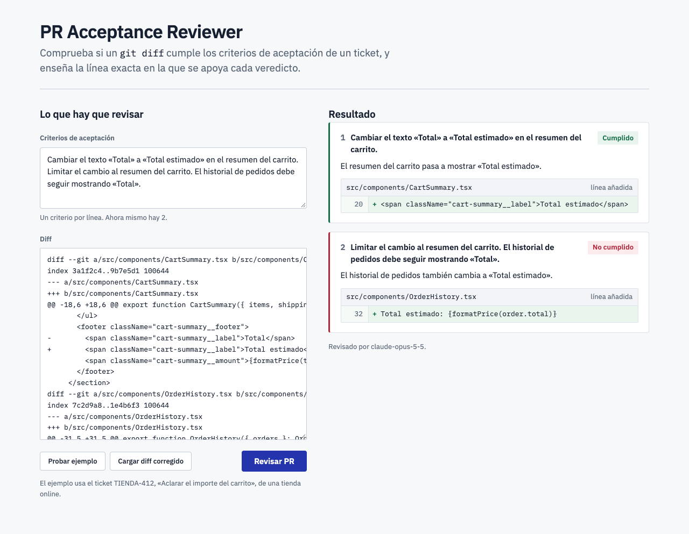

# PR Acceptance Reviewer

Pega los criterios de aceptación de un ticket y un `git diff`. La aplicación responde, criterio
por criterio, si el diff lo cumple — y enseña **la línea exacta del diff** en la que se apoya.



## El problema

Pedirle a un modelo «¿este diff cumple el ticket?» es fácil. El problema es creerle. Un modelo
puede afirmar con total aplomo que algo cambió en un archivo que ni siquiera aparece en el diff,
y quien revisa no tiene forma rápida de saberlo.

Aquí el veredicto del modelo es **una propuesta, no un resultado**. El backend obliga al modelo a
citar archivo, lado del diff, número de línea y fragmento; después busca esa línea en el diff que
él mismo interpretó. Si la cita no existe, apunta al archivo equivocado o el texto no coincide, el
criterio baja a **No verificado** y se explica por qué. La cita se enseña siempre junto a la
explicación, para que quien revisa pueda comprobar en un segundo si la evidencia sostiene la
conclusión.

Tres estados, y ninguno es «probablemente»:

| Estado | Qué significa |
|---|---|
| **Cumplido** | El diff lo cumple, y la línea que lo demuestra está verificada. |
| **No cumplido** | El diff lo incumple, y la línea que lo demuestra está verificada. |
| **No verificado** | El diff no da contexto suficiente, o la cita del modelo no se corresponde con ninguna línea del diff. |

## Cómo está montado

```
frontend/   React + TypeScript (Vite). Una pantalla.
backend/    Java 17 + Spring Boot. Un endpoint: POST /api/reviews.
examples/   Los dos diffs de la demo. Los usan la pantalla y las pruebas.
```

El navegador habla solo con el backend; **la credencial del modelo no sale nunca del servidor**.
En desarrollo, Vite hace de proxy de `/api` hacia `localhost:8080`.

Las piezas del backend, en el orden en que trabajan:

1. `DiffParser` interpreta el diff unificado y sitúa cada línea: archivo, lado y número. Si el
   texto no es un diff, falla aquí, antes de gastar una llamada al modelo.
2. `PromptBuilder` numera los criterios con un identificador (`C1`, `C2`, …) y le manda al modelo
   el diff ya anotado (`[ADDED 20] …`), para que citar bien le resulte más fácil que inventarse
   una referencia.
3. `ModelResponseParser` coloca cada veredicto en su identificador y valida lo que trae: estados
   conocidos, explicación, citas completas. Un veredicto que no se entiende tumba a su criterio,
   no a la revisión entera.
4. `EvidenceVerifier` compara cada cita con el diff de verdad y degrada lo que no cuadre.

Y cuando una cita se rechaza, la pantalla **no la enseña**, ni enseña la explicación que se
apoyaba en ella: deja solo el criterio, la etiqueta «No verificado» y qué falló al comprobarla.
Una explicación convincente junto a una cita falsa es peor que no decir nada.

## Requisitos

- Java 17 o superior
- Maven 3.9 o superior
- Node 18 o superior
- Una clave de la API de Claude

## Variables de entorno

| Variable | Obligatoria | Por defecto | Para qué |
|---|---|---|---|
| `ANTHROPIC_API_KEY` | sí | — | Clave de la API de Claude. |
| `REVIEWER_MODEL` | no | `claude-opus-5-5` | Modelo que revisa. |
| `REVIEWER_MAX_TOKENS` | no | `16000` | Tope de la respuesta del modelo. |
| `SERVER_PORT` | no | `8080` | Puerto del backend. |
| `ANTHROPIC_BASE_URL` | no | — | Para pasar por una pasarela propia. |

Hay una plantilla en [`.env.example`](.env.example). Spring Boot no lee `.env` por su cuenta:
expórtalas en la shell, o carga el archivo con `set -a && source .env && set +a`.

## Arrancar

Dos terminales.

**Backend** (desde `backend/`):

```bash
export ANTHROPIC_API_KEY=sk-ant-...
mvn spring-boot:run
```

**Frontend** (desde `frontend/`):

```bash
npm install
npm run dev
```

Abre **http://localhost:5173**. Si ese puerto está ocupado, Vite coge el siguiente y lo dice en su
salida.

Sin `ANTHROPIC_API_KEY`, la aplicación arranca igual y la pantalla dice qué falta en cuanto pulsas
«Revisar PR»; no se cae en el arranque.

## La demo, en menos de un minuto

El ejemplo es el ticket ficticio **TIENDA-412 — Aclarar el importe del carrito**, de una tienda
online, con dos criterios:

1. Cambiar el texto «Total» a «Total estimado» en el resumen del carrito.
2. Limitar el cambio al resumen del carrito. El historial de pedidos debe seguir mostrando «Total».

Luego:

1. **Probar ejemplo** carga un diff que cambia el texto en `CartSummary.tsx` **y también** en
   `OrderHistory.tsx`.
2. **Revisar PR** → el primer criterio sale **Cumplido**; el segundo, **No cumplido**, citando la
   línea 32 de `OrderHistory.tsx`.
3. **Cargar diff corregido** carga la versión que solo toca `CartSummary.tsx`.
4. **Revisar PR** → los dos criterios salen **Cumplidos**.

## La API

```
POST /api/reviews
{ "acceptanceCriteria": ["…", "…"], "diff": "diff --git …" }
```

```json
{
  "results": [
    {
      "criterion": "Cambiar el texto «Total» a «Total estimado» en el resumen del carrito.",
      "status": "MET",
      "explanation": "El resumen del carrito pasa a mostrar «Total estimado».",
      "evidence": {
        "file": "src/components/CartSummary.tsx",
        "side": "ADDED",
        "lineNumber": 20,
        "snippet": "<span className=\"cart-summary__label\">Total estimado</span>"
      },
      "verificationNote": null
    }
  ],
  "model": "claude-opus-5-5",
  "provider": "API de Claude",
  "officialProvider": true
}
```

`status` es `MET`, `NOT_MET` o `UNVERIFIED`; `explanation` es `null` cuando el modelo no llegó a
evaluar ese criterio, y `verificationNote` dice qué falló al comprobarlo.

`provider` dice quién atendió la petición de verdad. Si defines `ANTHROPIC_BASE_URL`, la respuesta
lo declara (`officialProvider: false`) y la pantalla avisa en grande de que eso no lo ha revisado
la API de Claude. Una pantalla que dice «Revisado por claude-opus-5-5» cuando detrás hay un
servidor de pruebas miente, y es una mentira cara.

Códigos de error: **400** si la petición o el diff no valen, **502** si de la respuesta del modelo
no se pudo aprovechar ni un veredicto, **503** si falta la credencial o no se pudo llegar al
modelo. Todos responden
`{"error": "…"}` con un mensaje pensado para enseñarlo en pantalla.

## Pruebas

```bash
cd backend  && mvn test     # 77 pruebas
cd frontend && npm test     # 14 pruebas
```

Las del backend cubren, entre otras cosas, las tres situaciones que decidieron el diseño: una cita
válida se respeta, una línea inventada degrada el criterio a No verificado, y una respuesta
inválida del modelo se convierte en un error con mensaje, no en un resultado vacío.

Las pruebas leen los diffs de `examples/`, los mismos que carga la pantalla: si alguien cambia un
ejemplo, las pruebas lo notan.

## Decisiones que quizá te preguntes

**Una respuesta a medias no tira la revisión.** Cada criterio va con su identificador y vuelve con
su resultado, siempre. Si el modelo se deja uno, ese criterio sale como No verificado diciendo que
el modelo no lo evaluó, y los demás se muestran con normalidad. La alternativa —fallar entero— deja
a quien revisa sin nada por culpa de un criterio.

**El formato de la respuesta lo impone el prompt, no un esquema de salida estructurada.** A
propósito: la aplicación tiene que seguir siendo correcta cuando el modelo ignora el formato, y ese
camino está cubierto por pruebas. Añadir salida estructurada encima sería una mejora, no un
sustituto de la validación.

**El diff se le manda anotado al modelo.** Cada línea lleva delante su archivo, su lado y su
número. Citar bien pasa a ser lo más fácil, y comprobar la cita después se vuelve exacto.

**La comparación del fragmento es tolerante con los espacios, no con el contenido.** Se admite
citar un trozo de la línea, con otra sangría, con el prefijo `+`/`-` o con la anotación del
prompt; no se admite citar algo que esa línea no dice, ni un fragmento tan corto que no distinga
nada (citar `;` no demuestra nada).

**El parser lleva la cuenta de las líneas que declara cada fragmento.** No es ceremonia: dentro de
un fragmento, una línea eliminada cuyo contenido empiece por `-- ` —un comentario de SQL— se
escribe `--- …` y es idéntica a una cabecera de archivo. Sin llevar la cuenta, el resto del
fragmento se perdería en silencio y un criterio del tipo «esto no debe cambiar» saldría Cumplido
sobre un diff mutilado.
