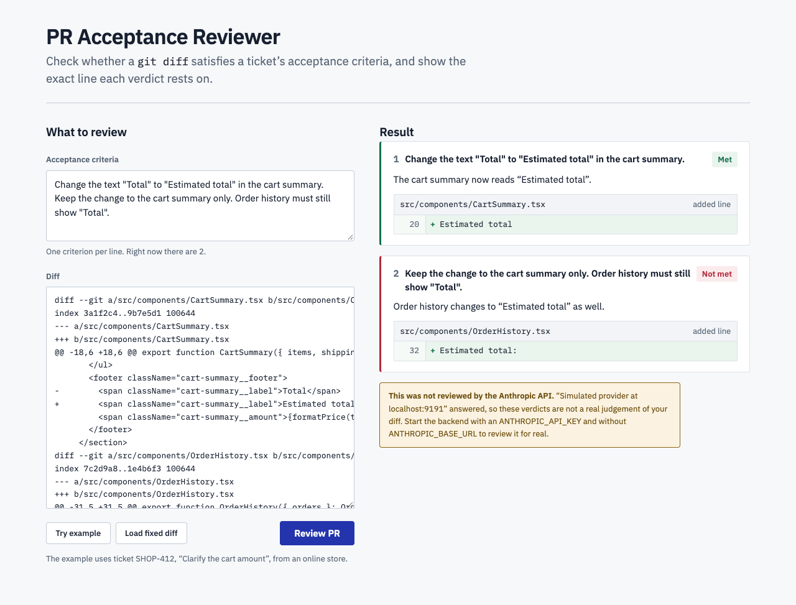

# PR Acceptance Reviewer

Check whether a code change actually does what the ticket asked — and show **the exact line of
the diff** each verdict rests on.

Two things live here:

- **[`skill/pr-acceptance-review`](skill/pr-acceptance-review)** — an installable skill for Claude
  Code, Codex and OpenCode. This is the main deliverable.
- **[`frontend`](frontend) + [`backend`](backend)** — a small web demo of the same idea: one
  screen, one endpoint, calling the Anthropic API from a Java service.



## The problem

Asking a model "does this diff meet the ticket?" is easy. Believing the answer is the hard part.
A model will state, with total confidence, that something changed in a file that is not even in
the diff, and a confident paragraph reads exactly like a correct one.

So here a verdict is **a proposal, not a result**. The model must cite file, side of the diff,
line number and snippet; then that line is looked up in the diff. If the citation does not exist,
points at the wrong file, or the text does not match, the criterion drops to **Not verified** and
says why — and the rejected citation is not shown, because an explanation that sounds right next
to evidence that does not exist is worse than saying nothing.

| Verdict | Meaning |
|---|---|
| **Met** | The diff satisfies it, and the line proving that is verified. |
| **Not met** | The diff violates it, and the line proving that is verified. |
| **Not verified** | The diff gives too little context, or the citation did not hold up. |

## The skill

### Install

The skill is one directory, `skill/pr-acceptance-review`, with a `SKILL.md` and two Python
scripts. It needs Python 3.9+ and nothing else.

```bash
git clone https://github.com/gloria-maki-dev/pr-acceptance-reviewer.git
cd pr-acceptance-reviewer
```

**Claude Code** — for every project:

```bash
mkdir -p ~/.claude/skills
cp -r skill/pr-acceptance-review ~/.claude/skills/
```

For one project only, copy it to `.claude/skills/` inside that repository instead.

**OpenCode** — for every project:

```bash
mkdir -p ~/.config/opencode/skills
cp -r skill/pr-acceptance-review ~/.config/opencode/skills/
```

For one project only, use `.opencode/skills/` inside that repository. OpenCode also reads
`.claude/skills/` and `.agents/skills/`, so a Claude Code install is picked up as well.

**Codex** — for every project:

```bash
mkdir -p ~/.agents/skills
cp -r skill/pr-acceptance-review ~/.agents/skills/
```

For one project only, use `.agents/skills/` inside that repository. Codex's skill paths have
moved between versions — if yours does not find it, check `codex --help` and the
[customization docs](https://developers.openai.com/codex/concepts/customization); some builds
look in `~/.codex/skills/` instead.

Restart the agent after copying, then ask it to review a PR against its acceptance criteria.

### Use

Give the agent the criteria and point it at the change:

> Review this branch against the ticket's acceptance criteria:
> 1. The export button must read "Download CSV".
> 2. The CSV separator must still be the semicolon.
> 3. The export endpoint must require authentication.

It captures the diff, annotates it, judges each criterion, verifies every citation, and reports:

| # | Criterion | Verdict | Evidence |
|---|---|---|---|
| 1 | The export button must read "Download CSV" | **Met** | `src/orders/exportCsv.ts:1` (added) |
| 2 | The CSV separator must still be the semicolon | **Not met** | `src/orders/exportCsv.ts:2` (added) |
| 3 | The export endpoint must require authentication | **Not verified** | — |

### Reviewing against a base branch

```bash
git diff main...HEAD > /tmp/review.diff      # what this branch added
git diff --staged > /tmp/review.diff         # what is about to be committed
gh pr diff 42 > /tmp/review.diff             # a GitHub pull request
```

Use `main...HEAD` with three dots, so you see what the branch added rather than everything `main`
moved on to. Replace `main` with the real base branch.

### Running the scripts by hand

```bash
cd skill/pr-acceptance-review

# 1. Annotate: every line tagged with its file, side and line number
git diff main...HEAD | python3 scripts/annotate_diff.py

# 2. Verify a set of verdicts against that diff
python3 scripts/verify_citations.py \
  --diff /tmp/review.diff \
  --verdicts /tmp/verdicts.json \
  --criteria /tmp/criteria.txt \
  --format markdown
```

### Worked example

Acceptance criteria (`/tmp/criteria.txt`, one per line):

```text
The exportButtonLabel constant must have the value "Download CSV".
The CSV separator must still be the semicolon.
The export endpoint must require authentication.
```

The diff:

```diff
diff --git a/src/orders/exportCsv.ts b/src/orders/exportCsv.ts
--- a/src/orders/exportCsv.ts
+++ b/src/orders/exportCsv.ts
@@ -1,5 +1,5 @@
-export const exportButtonLabel = 'Export';
-const separator = ';';
+export const exportButtonLabel = 'Download CSV';
+const separator = ',';

 export function exportCsv(orders: Order[]): string {
   const header = ['id', 'customer', 'total'].join(separator);
```

`annotate_diff.py` turns that into citable lines:

```
FILE: src/orders/exportCsv.ts
[REMOVED 1] export const exportButtonLabel = 'Export';
[REMOVED 2] const separator = ';';
[ADDED 1] export const exportButtonLabel = 'Download CSV';
[ADDED 2] const separator = ',';
```

Criterion 1 is **Met** citing `ADDED 1`; criterion 2 is **Not met** citing `ADDED 2`; criterion 3
is **Not verified**, because the endpoint is nowhere in the diff.

### Tests

```bash
cd skill/pr-acceptance-review
python3 -m unittest discover -s scripts -t scripts
```

## The web demo

The same idea with a screen in front of it: paste criteria and a diff, press **Review PR**.

### Requirements

- Java 17 or newer
- Maven 3.9 or newer
- Node 18 or newer
- An Anthropic API key

### Start it

Two terminals.

**Backend** (port **8080**):

```bash
cd backend
export ANTHROPIC_API_KEY=sk-ant-your-key-here
mvn spring-boot:run
```

**Frontend** (port **5173**):

```bash
cd frontend
npm install
npm run dev
```

Open **http://localhost:5173**. If that port is taken, Vite picks the next one and prints the URL
it chose. Vite proxies `/api` to the backend, so the browser only ever talks to the frontend and
the model credential never leaves the server.

Without `ANTHROPIC_API_KEY` the application still starts; the screen says what is missing as soon
as you press **Review PR**.

### Demo steps

The example is the fictional ticket **SHOP-412 — Clarify the cart amount**, with two criteria:

1. Change the text "Total" to "Estimated total" in the cart summary.
2. Keep the change to the cart summary only. Order history must still show "Total".

Then:

1. **Try example** loads a diff that changes the text in `CartSummary.tsx` **and also** in
   `OrderHistory.tsx`.
2. **Review PR** → criterion 1 is **Met**; criterion 2 is **Not met**, citing line 32 of
   `OrderHistory.tsx`.
3. **Load fixed diff** loads the version that only touches `CartSummary.tsx`.
4. **Review PR** → both criteria are **Met**.

### Environment variables

| Variable | Required | Default | What for |
|---|---|---|---|
| `ANTHROPIC_API_KEY` | yes | — | Anthropic API key. |
| `REVIEWER_MODEL` | no | `claude-opus-5-5` | The model that reviews. |
| `REVIEWER_MAX_TOKENS` | no | `16000` | Cap on the model's answer. |
| `SERVER_PORT` | no | `8080` | Backend port. |
| `ANTHROPIC_BASE_URL` | no | — | Route through a gateway of your own, or a test server. |

There is a template in [`.env.example`](.env.example). Spring Boot does not read `.env` on its
own: export the variables, or load the file with `set -a && source .env && set +a`.

### Simulated mode

Setting `ANTHROPIC_BASE_URL` points the backend somewhere other than the Anthropic API — a
gateway of your own, or a stub server for demoing without a key:

```bash
cd backend
export ANTHROPIC_API_KEY=anything-non-empty
export ANTHROPIC_BASE_URL=http://localhost:9191
mvn spring-boot:run
```

**The screen says so, in as many words.** The response carries `provider` and `officialProvider`,
and when the answer did not come from the Anthropic API the result panel shows:

> **This was not reviewed by the Anthropic API.** "Simulated provider at localhost:9191"
> answered, so these verdicts are not a real judgement of your diff.

That warning exists because a screen reading "Reviewed by claude-opus-5-5" while a test server is
answering is a lie, and an expensive one: the reviewer believes verdicts nobody thought about.

To go back to the real provider, `unset ANTHROPIC_BASE_URL` and restart.

### The API

```
POST /api/reviews
{ "acceptanceCriteria": ["…", "…"], "diff": "diff --git …" }
```

```json
{
  "results": [
    {
      "criterion": "Change the text \"Total\" to \"Estimated total\" in the cart summary.",
      "status": "MET",
      "explanation": "The cart summary now reads \"Estimated total\".",
      "evidence": {
        "file": "src/components/CartSummary.tsx",
        "side": "ADDED",
        "lineNumber": 20,
        "snippet": "<span className=\"cart-summary__label\">Estimated total</span>"
      },
      "verificationNote": null
    }
  ],
  "model": "claude-opus-5-5",
  "provider": "Anthropic API",
  "officialProvider": true
}
```

`status` is `MET`, `NOT_MET` or `NOT_VERIFIED`. `explanation` is `null` when the model never
evaluated that criterion, and `verificationNote` says what failed when checking it.

Error codes: **400** when the request or the diff is invalid, **502** when nothing in the model's
answer could be used, **503** when the credential is missing or the model could not be reached.
All of them return `{"error": "…"}` with a message meant to be shown on screen.

### Tests

```bash
cd backend  && mvn test     # 77 tests
cd frontend && npm test     # 14 tests
```

The backend tests read the diffs from `examples/`, the same files the screen loads: change an
example and the tests notice.

## How it works

```
frontend/   React + TypeScript (Vite). One screen.
backend/    Java 17 + Spring Boot. One endpoint: POST /api/reviews.
skill/      The installable skill and its scripts.
examples/   The two demo diffs, shared by the screen and the tests.
```

The backend pieces, in the order they work:

1. `DiffParser` reads the unified diff and places every line: file, side, number. If the text is
   not a diff it fails here, before spending a call to the model.
2. `PromptBuilder` numbers the criteria (`C1`, `C2`, …) and sends the model the annotated diff
   (`[ADDED 20] …`), so citing correctly is easier than inventing a reference.
3. `ModelResponseParser` places each verdict on its identifier and validates what it carries. A
   verdict that cannot be read sinks its own criterion, not the whole review.
4. `EvidenceVerifier` compares every citation with the real diff and downgrades what does not
   line up.

## Decisions you might ask about

**A half-answer does not sink the review.** Each criterion goes to the model with an identifier
and comes back with its own result, always. If the model skips one, that criterion comes back as
Not verified saying it was not evaluated, and the others display normally. Failing the whole
request leaves the reviewer with nothing because of one criterion.

**The response format comes from the prompt, not from a structured-output schema.** On purpose:
the application has to stay correct when the model ignores the format, and that path is covered
by tests. Adding structured output on top would be an improvement, not a replacement for the
validation.

**The parser counts the lines each hunk declares.** Not ceremony: inside a hunk, a removed line
whose content starts with `-- ` — a SQL comment — is written `--- …` and is indistinguishable
from a file header. Without the countdown the rest of the hunk would vanish in silence, and a
"this must not change" criterion would come back Met over a mutilated diff.

**Snippet matching is lenient about whitespace, strict about content.** You may quote part of a
line, with different indentation, with the `+`/`-` prefix or with the prompt's annotation. You
may not quote something the line does not say, nor a fragment so short it distinguishes nothing
(citing `;` proves nothing).
